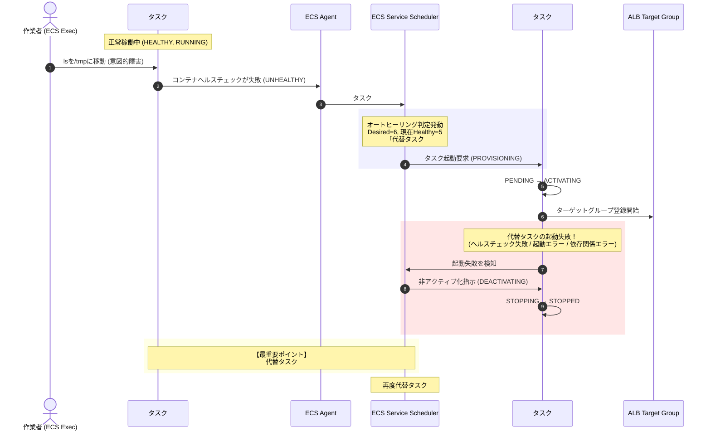

# ECSオートヒーリング徹底解剖：ヘルスチェック異常タスクの非停止と代替タスクの非アクティブ化停止の真因

## 1. 結論（Executive Summary）

### 結論：これはECSの仕様上「完全に発生しうる事象」であり、ECSの可用性保護機構が正常に働いている結果です

本件において発生している2つの現象：
1. **「Desired Count = 6 の環境で、バックコンテナのヘルスチェックが異常（UNHEALTHY）になったにもかかわらず、6個目のタスクが停止（STOPPED）せずに動き続けている」**
2. **「代替タスクが何度も起動しようとしては、非アクティブ化（DEACTIVATING）から停止（STOPPED）してしまう」**

これらは別々のバグではなく、**「まったく同一の因果関係でつながった1つの現象（デッドロック的状態）」** です。

```
【根本原因の因果関係】
代替タスクが何らかの理由で起動失敗（DEACTIVATING → STOPPED）を繰り返している
  │
  ▼（交代要員が正常にならない！）
ECSサービススケジューラーの「可用性最優先原則（Rolling Replacement & Minimum Healthy Percent保護）」が発動
  │
  ▼（いま異常タスクを強制終了するとサービス提供能力がさらに損なわれる！）
交代が完了するまで、異常（UNHEALTHY）な6個目のタスクの停止命令（SIGTERM）が意図的に保留される
  │
  ▼
結果：異常なタスクが生き残り続け、裏で代替タスクが死に続ける「無限リトライループ」が発生する
```

---

## 2. 小学生でも絶対にわかる！身近なたとえ話

### 「大人気ハンバーガーショップの『6番レジ係』の悲劇」

難しいクラウド用語を一旦忘れて、**大人気ハンバーガーショップの店内** を想像してみてください。

#### ① お店の基本ルール
* お店の店長さん（**ECSサービススケジューラー**）は、社長からこう厳しく言われています。
  > **「お昼時は絶対にレジを6台開けておけ！（Desired Count = 6）」**
  > **「もしレジが減ったら大行列になってお店が大混乱になるから、絶対に勝手にレジを閉めるな！（Minimum Healthy Percent = 100%）」**
* レジには、1番から6番まで **6人の店員さん（タスク）** が立って接客しています。

#### ② 事件発生（ヘルスチェック異常）
* 6番レジの店員さん（**6個目のタスク**）が、注文画面を動かすためのマウス（**lsコマンド**）をどこかに持っていかれてしまい（**/tmpに移動**）、注文を受けられなくなってしまいました。
* 6番の店員さんは店長に言いました。
  > **「店長！マウスがなくてお仕事ができません！お腹も痛くなってきました！（UNHEALTHY）」**

#### ③ 普通の大人の発想と、店長（ECS）の判断の違い
* **普通の大人の発想**:
  「お仕事ができないなら、すぐに早退して病院に行かせればいいじゃないか！（コンテナを即座に強制終了/STOPPED）」
* **でも店長（ECS）は絶対に帰らせません！**:
  なぜなら店長はこう考えるからです。
  > **「いま6番レジを帰らせたら、レジが5台になってお店がパンクしてしまう！ 交代のアルバイト（代替タスク）がタイムカードを押してエプロンをつけてレジに立つまで、6番は絶対に帰るな！そこに立っていろ！」**

#### ④ 最大の悲劇発生（非アクティブ化から停止）
* 店長は急いで代わりのアルバイト（**代替タスク**）を電話で呼び出しました。
* ところが、やってきたアルバイトたちは次々とトラブルを起こします：
  * **1人目**: お店の裏口の暗証番号がわからずドアが開けられない（タスク定義の起動時エラー）
  * **2人目**: エプロンを着ようとしたら破れていて諦めて帰ってしまう（マウント元 /mnt/logs のパーミッション・容量エラー）
  * **3人目**: レジに立つ前の検温チェック（ALBのターゲットグループヘルスチェック）で引っかかって失格になる
* これが、**「代替タスクが非アクティブ化（DEACTIVATING）から停止（STOPPED）する」** という状態です。

#### ⑤ 結論：なぜ6番の店員さんは居残り続けるのか？
* 新しいアルバイトが何人来てもレジに立てないため、**お腹が痛くて動けない6番の店員さんは、痛みに耐えながら（UNHEALTHYのまま）ずーーーーっとレジに立ち続けさせられている** のです。

これが、お客様のECSクラスターの中で起きていることのすべてです。

---

## 3. なぜこの仕組みが必要になったのか？〜歴史と背景〜

ECSがなぜこのような「一見不親切にも見える挙動」をするのかは、コンテナオーケストレーションの進化の歴史を知ると深く納得できます。

### 黎明期（2014年〜2016年頃）：即座にコンテナを殺していた時代の悲劇

Dockerが登場した初期、および初期のコンテナ管理スクリプトでは、**「ヘルスチェックがエラーになったら即座にプロセスをKillして再起動する」** という単純な実装が一般的でした。

しかし、本番環境の大規模サービスで以下の **「破滅的な連鎖障害（カスケード障害 / 死の連鎖）」** が多発しました：

1. **アクセス急増による一時的な息切れ**
   お昼休みにアクセスが殺到し、WebサーバーコンテナのCPUが100%に張り付き、ヘルスチェックの応答が1回タイムアウトした。
2. **即時Killの発動**
   「異常だ！」と判定され、そのコンテナが即座に強制終了（SIGKILL）。
3. **残存コンテナへの負荷集中（ドミノ倒し）**
   1台減ったことで、残った5台のコンテナにさらに大量のリクエストが流れ込む。
   残りのコンテナも次々と息切れを起こしてヘルスチェック失敗し、**数秒の間に全コンテナが一斉にKill** された。
4. **起動時過負荷による全滅ループ**
   新しく立ち上がろうとするコンテナも、起動直後に大量のリクエストを浴びて即死。システムが完全に沈黙（全断）した。

### 進化と解決策（2017年〜現在）：アベイラビリティ最優先と多層保護の確立

AWSのエンジニアたちはこの教訓から、**「中途半端に動いているコンテナであっても、新しく正常な代替コンテナが完全に稼働準備を整えるまでは、安易に殺してはならない」** というアーキテクチャへと舵を切りました。

1. **Rolling Replacement（ローリング置換）の導入**
   デプロイ時だけでなく、障害によるオートヒーリング時にも「新タスクの起動確認後に旧タスクを削除する」ステップを共通化。
2. **`minimumHealthyPercent`（最小正常パーセント）による安全弁**
   Desired Count（希望タスク数）に対して、「何％の正常タスクを維持しなければならないか」を厳密に計算。正常タスク数がこの閾値を下回る場合、異常タスクの停止はブロックされる。
3. **ライフサイクルの細分化（ACTIVATING / DEACTIVATINGの登場）**
   タスクの急激な停止による通信断を防ぐため、ターゲットグループの登録解除（Draining）、リソースの後片付けなどを段階的に行うステートマシンが確立された。

---

## 4. ECSオートヒーリングの動作原理とステートマシン

### 4.1 ECSタスクの完全ライフサイクル

```
【起動フェーズ】
[PROVISIONING] ── AWSリソース（ENI、EBS/EFSボリュームなど）の割り当て
      │
      ▼
  [PENDING]    ── コンテナエージェントがイメージ取得や起動準備
      │
      ▼
 [ACTIVATING]  ── ロードバランサー（ALB/NLB）への登録、サービスディスカバリ登録
      │
      ▼
  [RUNNING]    ── コンテナが稼働中。コンテナヘルスチェックが定期実行される

【停止フェーズ】
[DEACTIVATING] ── ロードバランサーからの登録解除（Draining待機）、サービス連携解除
      │
      ▼
  [STOPPING]   ── コンテナプロセスへSIGTERM送信、停止猶予時間（StopTimeout）の待機
      │
      ▼
  [STOPPED]    ── コンテナプロセス終了（SIGKILL含む）、ENI解放、タスク完全停止
```

### 4.2 今回の障害シナリオにおける詳細シーケンス



---

## 5. 代替タスクが「非アクティブ化（DEACTIVATING）」から停止してしまう5大原因

代替タスクが `DEACTIVATING` から `STOPPED` になる原因は、現場のアーキテクチャによって主に以下の5つに分類されます。

| 分類 | 主な原因 | 詳細メカニズムと発生状況 | 可能性・影響度 |
| :--- | :--- | :--- | :--- |
| **① ELBヘルスチェック猶予期間不足** | `healthCheckGracePeriodSeconds` が0秒または短すぎる | 代替タスクがALB/NLBに登録されたが、アプリの初期化完了前にALBがヘルスチェックを送信し、失敗と判定して即座に切り離し（DEACTIVATING）へ回された。 | **★★★★★ (最頻出)** |
| **② コンテナチェック初期猶予不足** | `healthCheck.startPeriod` が未設定 | タスク定義のコンテナヘルスチェックに起動猶予がなく、コンテナ起動直後にチェックコマンドが実行され、初期化未完了で失敗と判定された。 | **★★★★☆ (高頻出)** |
| **③ ボリューム・マウント依存** | `/mnt/logs` のパーミッション・容量・共有ロック | マウントされているボリュームがEFSやホストパスの場合、新しいタスクが同じパスにアクセスできずエラー、あるいはテスト時の変更が影響している。 | **★★★★☆ (要注意)** |
| **④ ポート重複 / リソース枯渇** | EC2ホストポート競合 / ENI・IP枯渇 | EC2起動タイプで `hostPort` が固定されていると同一インスタンスでポート競合する。awsvpcモードでサブネットの空きIPが枯渇している。 | **★★★☆☆ (環境依存)** |
| **⑤ デプロイサーキットブレーカー** | Deployment Circuit Breaker の自動ロールバック | 代替タスクの起動失敗が連続したため、ECSのサーキットブレーカーが発動し、新タスクの起動を強制キャンセルしている。 | **★★☆☆☆ (機能有効時)** |

---

## 6. 現場で今すぐ使える調査・トラブルシューティング手順（5分確定診断）

### Step 1: 停止した代替タスクのタスクARNを特定する
```bash
aws ecs list-tasks \
    --cluster <クラスター名> \
    --service-name <サービス名> \
    --desired-status STOPPED \
    --max-items 5
```

### Step 2: 停止理由（stoppedReason）とコンテナ終了コードを確認する
```bash
aws ecs describe-tasks \
    --cluster <クラスター名> \
    --tasks <停止したタスクARN> \
    --query "tasks[].[taskArn, stoppedReason, stopCode, containers[].[name, exitCode, reason]]" \
    --output json
```

> **判定基準**:
> - `stoppedReason` に `Task failed container health checks` とある場合 ➔ コンテナ内ヘルスチェックの `startPeriod` やコマンドを見直す。
> - `stoppedReason` に `Task failed ELB health checks in (target-group ...)` とある場合 ➔ サービスの `healthCheckGracePeriodSeconds` を延長する（例: 60〜300秒）。
> - `ResourceInitializationError` がある場合 ➔ サブネットの空きIPやEFSボリューム設定を確認する。

### Step 3: ECSサービスイベントの直近ログを確認する
```bash
aws ecs describe-services \
    --cluster <クラスター名> \
    --services <サービス名> \
    --query "services[0].events[0:10].[createdAt, message]" \
    --output table
```

---

## 7. 成果物ファイルのご案内

本リサーチ結果は、現場での共有・レビューおよび経営層・非エンジニア向け説明にもご活用いただけるよう、2つの形式で納品しております。

1. **Markdownドキュメント（本ファイル）**:
   - `C:\Users\taka_\Agy\ECS_Auth_Healing_Agy\ECS_Auto_Healing_Deep_Dive.md`
2. **Excelドキュメント（Meiryo UI / モノトーンスタイル）**:
   - `C:\Users\taka_\Agy\ECS_Auth_Healing_Agy\ECS_Auto_Healing_Analysis.xlsx`
   - 全シートで **Meiryo UI** フォントを統一適用。
   - 上品で落ち着いた **ビジネスモノトーンカラー（黒・濃灰・淡灰・白）** でデザイン。
   - 全6シート構成（事象総括、ライフサイクル、原因マトリクス、歴史的背景、小学生向けストーリー、トラブルシューティング手順）。
